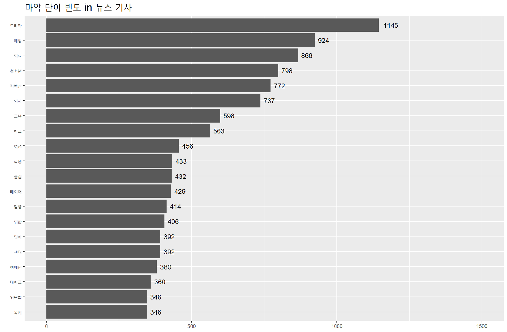
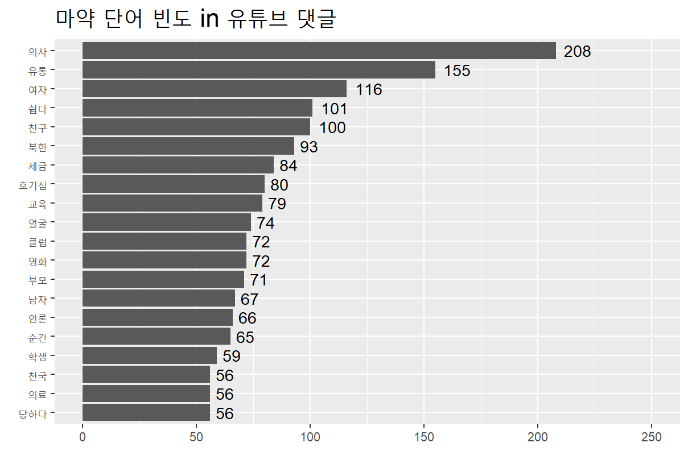
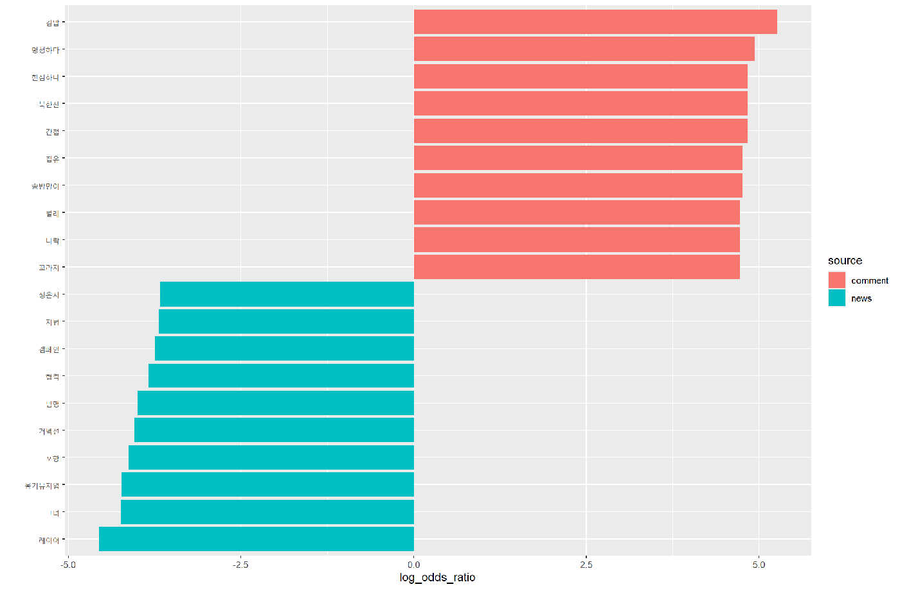
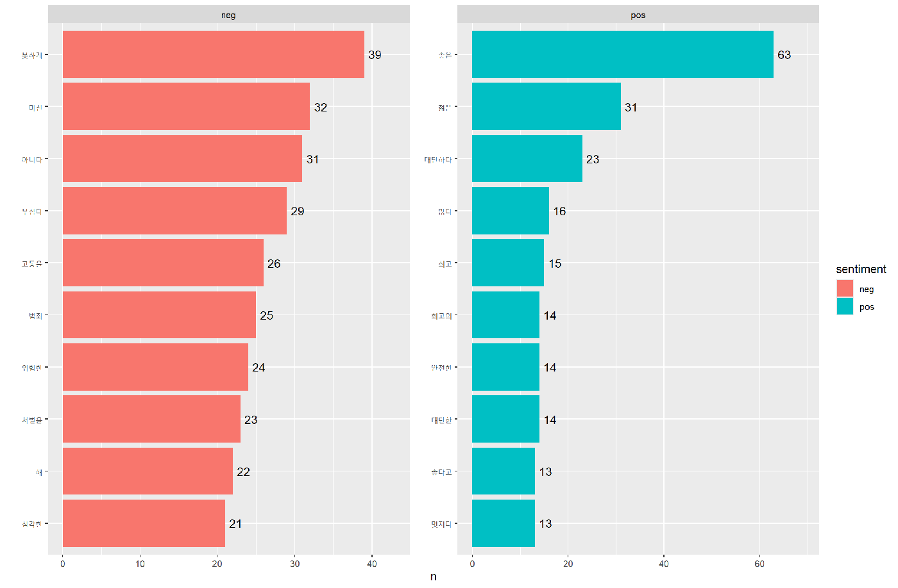
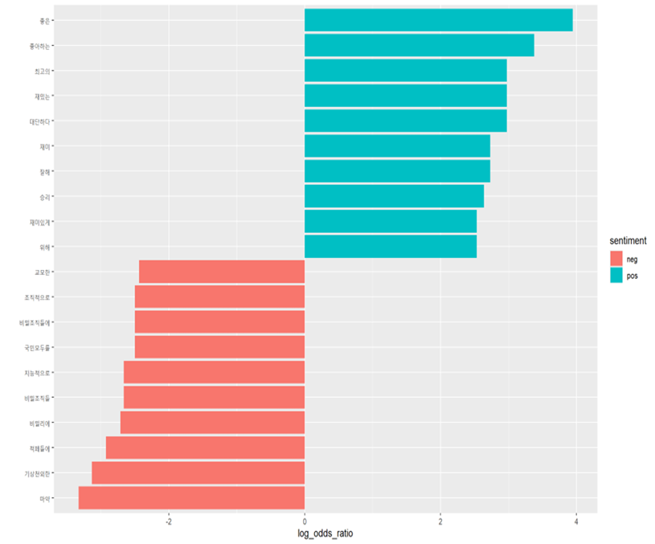
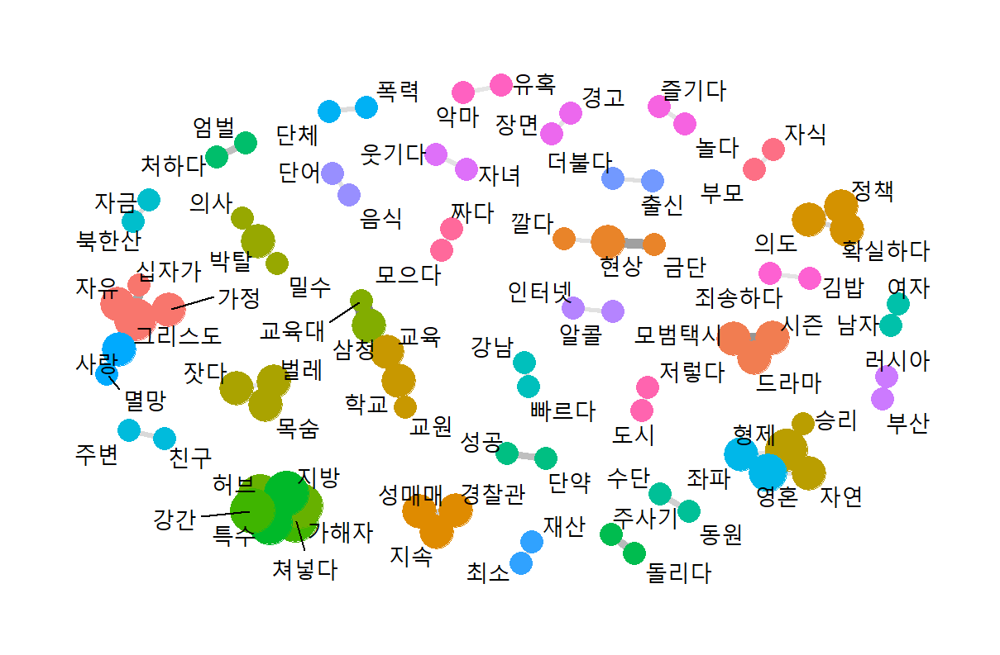
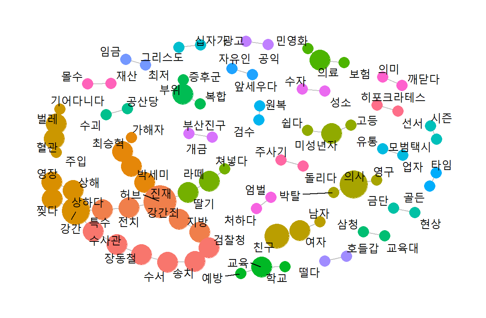
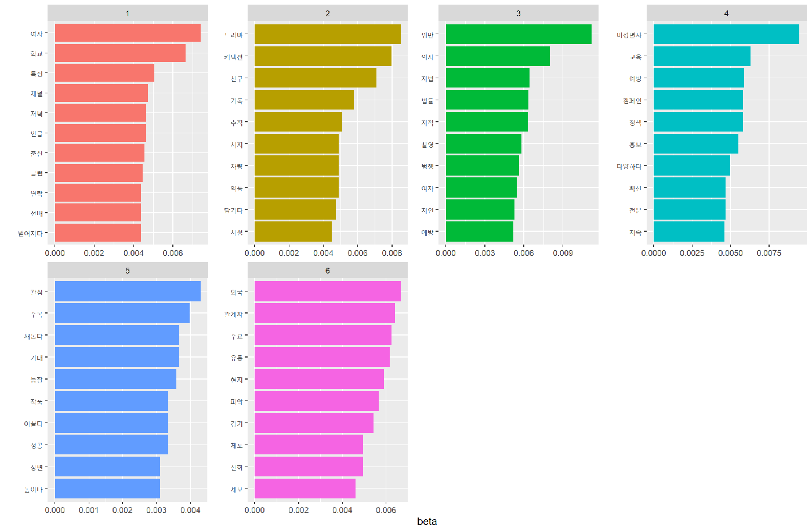
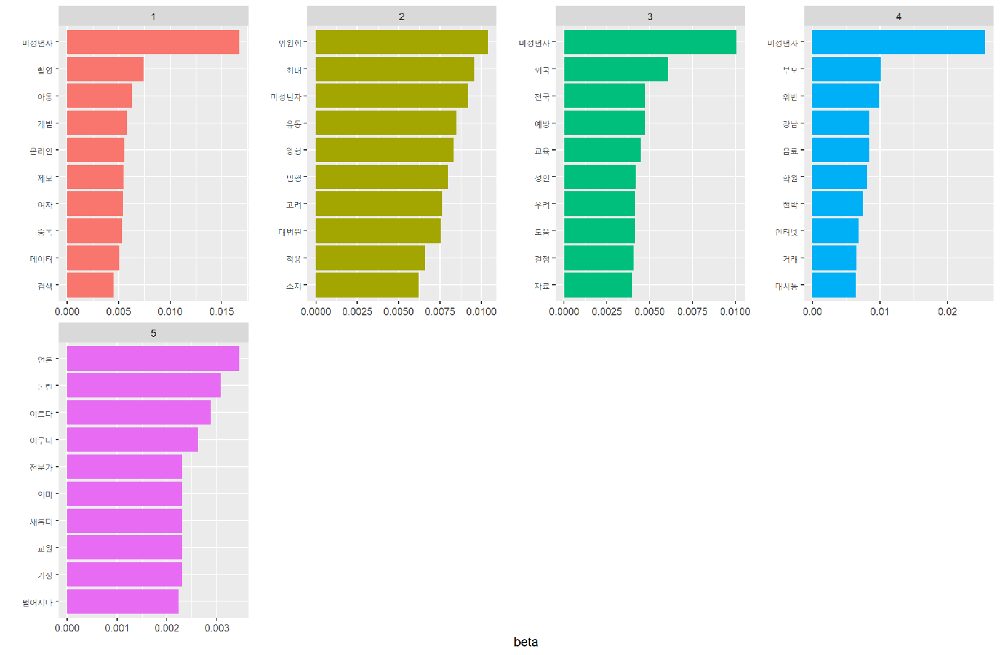

# 국내 마약 이슈에 대한 대중 인식과 뉴스 경향 분석

네이버 뉴스 기사와 유튜브 댓글을 텍스트마이닝으로 비교해, **언론이 마약을 다루는 방식**과 **대중이 마약 관련 콘텐츠를 받아들이는 방식**이 어떻게 다른지 살펴본 프로젝트입니다. 인문사회과학 텍스트마이닝 수업의 개인 프로젝트로 R을 사용했습니다 (2024.06).

> **한 줄 결론**
> 뉴스는 마약을 **범죄·예방** 프레임으로 다루지만, 유튜브 댓글은 **일상·감정** 언어로 반응합니다. 마약을 다룬 드라마·영화 댓글에서는 '무섭다'보다 '재밌다'가 훨씬 많았습니다.

## 리서치 질문

1. 뉴스 기사는 마약 이슈를 어떤 방향으로 다루는가?
2. 유튜브 댓글은 마약 관련 영상에 어떤 감정과 태도로 반응하는가?
3. 뉴스의 프레임과 대중의 반응은 일치하는가, 분리되는가?

## 데이터

| 데이터 | 규모 | 수집 |
|---|---|---|
| 네이버 뉴스 기사 ('마약' 키워드) | 1,926건 (2024.06.13~18) | 네이버 검색 API + 본문 크롤링 |
| 네이버 뉴스 기사 (미성년자 관련 마약 기사) | 985건 (2023.12~2024.06) | 네이버 검색 API + 본문 크롤링 |
| 유튜브 댓글 (마약 관련 영상) | 약 12,700개 | 영상별 댓글 수집 |
| 유튜브 댓글 (마약 소재 드라마·영화 영상) | 약 9,500개 | 영상별 댓글 수집 |

## 분석 흐름

| 스크립트 | 분석 | 대상 |
|---|---|---|
| [01_news_word_freq](R/01_news_word_freq.R) | 단어 빈도, 워드클라우드 | 뉴스 |
| [02_youtube_word_freq](R/02_youtube_word_freq.R) | 단어 빈도, 워드클라우드 | 댓글 |
| [03_news_vs_youtube_log_odds](R/03_news_vs_youtube_log_odds.R) | 로그 오즈비로 뉴스·댓글 특징어 비교 | 뉴스 vs 댓글 |
| [04_youtube_sentiment](R/04_youtube_sentiment.R) | KNU 감성사전 기반 긍·부정 단어 | 댓글 |
| [05_youtube_network](R/05_youtube_network.R) | 동시출현, 파이 계수 네트워크, 바이그램 네트워크 | 댓글 |
| [06_moviedrama_word_freq](R/06_moviedrama_word_freq.R) | 단어 빈도, 워드클라우드 | 드라마·영화 댓글 |
| [07_moviedrama_sentiment](R/07_moviedrama_sentiment.R) | 댓글별 감성 점수, 긍·부정 로그 오즈비 | 드라마·영화 댓글 |
| [08_news_lda_build](R/08_news_lda_build.R) → [09](R/09_news_lda_visualize.R) | LDA 토픽모델링 (k=6), LDAvis | 뉴스 |
| [10_teen_news_lda_build](R/10_teen_news_lda_build.R) → [11](R/11_teen_news_lda_visualize.R) | LDA 토픽모델링 (k=5), LDAvis | 미성년자 관련 뉴스 |

**전처리 공통**: 한글 외 문자 제거 → NLP4kec 형태소 분석(사용자 사전 적용) → 불용어 제거 → 동의어 통일 → 2글자 이상 단어만 사용. 토픽모델링에서는 중복 기사와 3어절 미만 문장을 빼고, 지나치게 흔한 단어(1,000~1,200회 초과)를 제거했습니다.

## 주요 결과

### 1. 뉴스는 정보 전달, 댓글은 감정 평가

<p>


</p>

- **뉴스**: 드라마, 예방, 의료, 청소년 등이 상위였습니다. 당시 방영 중이던 마약 소재 드라마 관련 기사가 많았습니다.
- **댓글**: 의사, 여자, 친구, 쉽다, 호기심 등 사건과 개인 경험 중심 단어가 많았습니다.



로그 오즈비로 비교하면 차이가 더 분명합니다.
- **댓글 특징어**(빨강): '마약김밥' 같은 일상 표현, '멍청하다·한심하다' 같은 평가, '집유·솜방망이' 같은 처벌 불신
- **뉴스 특징어**(파랑): 캠페인, 협력, 범행, 지법 같은 사건·정책 용어와 드라마·출연자 이름

### 2. 위험하지만 '콘텐츠'로 소비되는 마약

<p>


</p>

- 일반 마약 영상 댓글에서는 '무섭다, 위험한, 심각한' 같은 부정어가 많아 위험성은 인식하고 있었습니다.
- 그런데 마약을 소재로 한 **드라마·영화 댓글**에서는 '재밌다'가 압도적이었고 '무섭다'는 그보다 적었습니다. 경각심보다 재미로 소비되는 경향이 확인됐습니다.

<p>


</p>

댓글 네트워크에서는 '강간·가해자·허브(신종 마약)' 같은 **범죄·수사** 군집과 '놀다·즐기다·강남' 같은 **일상·오락** 군집이 함께 나타났고, '호들갑·떨다'처럼 문제를 가볍게 보는 반응도 있었습니다.

### 3. 미성년자 문제로 확장되는 마약 담론

<p>


</p>

| 전체 뉴스 (6개 토픽) | 미성년자 관련 뉴스 (5개 토픽) |
|---|---|
| 해외·메신저를 통한 유통 | 강남 학원가 마약 음료 사건 |
| 미성년자 마약과 예방 캠페인 | 미성년자 대상 마약 범죄 판결 |
| 마약 소재 콘텐츠에 대한 관심 | 학교·지자체 예방 교육 |
| 유흥가·연예계 마약 | 마약과 성범죄의 악순환 |
| 의사의 직업적 마약 남용 | 언론의 마약 보도 |
| 마약 소재 드라마 | |

미성년자 관련 뉴스에서는 학원가, 판결, 예방, 불법 촬영 등 **취약 집단을 직접 위협하는 구조적 문제**로 토픽이 모였습니다.

## 시사점

- 마약 소재가 오락 콘텐츠로 반복 노출되면 위험성에 대한 감각이 무뎌질 수 있어, 제작 측의 책임 있는 묘사와 노출 가이드라인이 필요합니다.
- 미성년자 대상 마약 문제는 성범죄·불법 촬영과 맞물린 악순환 구조로 나타나, 단속뿐 아니라 학교·지역 단위의 조기 교육과 개입이 필요합니다.

## 한계

- 뉴스는 2024년 6월 중순 약 일주일치라, 당시 화제였던 드라마와 특정 사건의 영향이 큽니다.
- 감성 분석은 사전 기반이라 '마약김밥'처럼 맥락이 다른 표현이나 반어를 구분하지 못합니다.
- 유튜브 댓글은 영상 선택과 알고리즘 노출에 따라 표본이 편향될 수 있습니다.
- 일부 스크립트에서 전처리한 열이 아니라 원문 열을 토큰화하는 부분(06번)이나 `replace_html()` 결과가 덮어써지는 부분(04·07번)이 있어, 수정 후 재분석하면 결과가 조금 달라질 수 있습니다.

## 폴더 구조

```
text-mining-project/
├── R/       분석 스크립트 (01 → 11)
├── dict/    사용자 사전, 불용어, 동의어 사전 (직접 구축)
├── images/  분석 결과 그래프
└── data/    원본 데이터 위치 (저장소에는 포함하지 않음)
```

## 실행 방법

1. R과 패키지를 설치합니다: `tidyverse`, `tidytext`, `NLP4kec`(rJava 필요), `textclean`, `tm`, `topicmodels`, `LDAvis`, `servr`, `widyr`, `tidygraph`, `ggraph`, `wordcloud`
2. [KNU 한국어 감성사전](https://github.com/park1200656/KnuSentiLex)을 받아 `dict/knu_sentiment_lexicon.csv`로 저장합니다.
3. 수집한 뉴스·댓글 파일을 `data/`에 둡니다 ([data/README.md](data/README.md) 참고).
4. 저장소 최상위 폴더를 작업 디렉터리로 두고 스크립트를 번호 순서대로 실행합니다.

## 사용 기술

R, tidytext, NLP4kec, topicmodels (LDA), LDAvis, widyr, tidygraph, ggraph, KNU 감성사전
